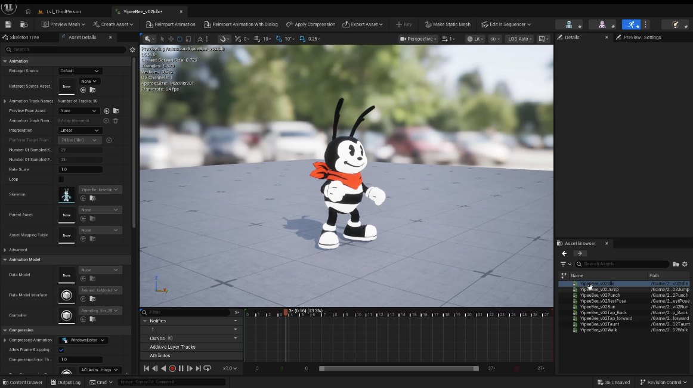

# RIG2U5: rigging and exporting game characters, made easier

RIG2U5 extends Blender's Rigify to build character rigs that work in Unreal Engine 5. It supports full facial and body rigs and includes U5, A, T and X pose templates.

- **Rigify to Unreal export:** FBX fully compatible with Unreal's IK Rig.
- **Animation workflow:** export and import facial and body animation with Unreal's default settings.
- **Clean keyframes:** animate with Rigify controls, export streamlined keys.
- **Non-destructive:** adjust and regenerate the rig at any stage.
- **Reuse:** append animation from one character to another with the same rig.
- **Unreal ready:** works with IK Retargeter and Modular Control Rig.

## Start here

1. [Installation](Installation)
2. [Root Rig Workflow](Root-Rig-Workflow): bind your model to the ready-made U5 skeleton.
3. [U5 Metarig Workflow](U5-Metarig-Workflow): fit a metarig to your model and generate the full control rig.

[Release Notes](Release-Notes) · [Bug Report & Support](Bug-Report-and-Support)

## COMING SOON: Toon limb support

