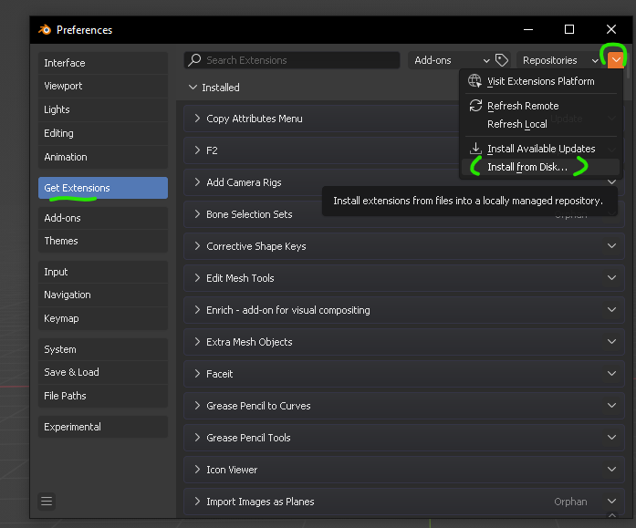

# Installation

In Blender, go to **Edit > Preferences > Get Extensions > Install from Disk** and pick the addon `.zip` file.

## Updating the addon

1. Remove the old version of the addon.
2. Install the latest version.
3. Restart Blender.

> **Warning:** always remove the old version first. Installing a new version over the old one does not replace the old files, and this causes most update errors.
