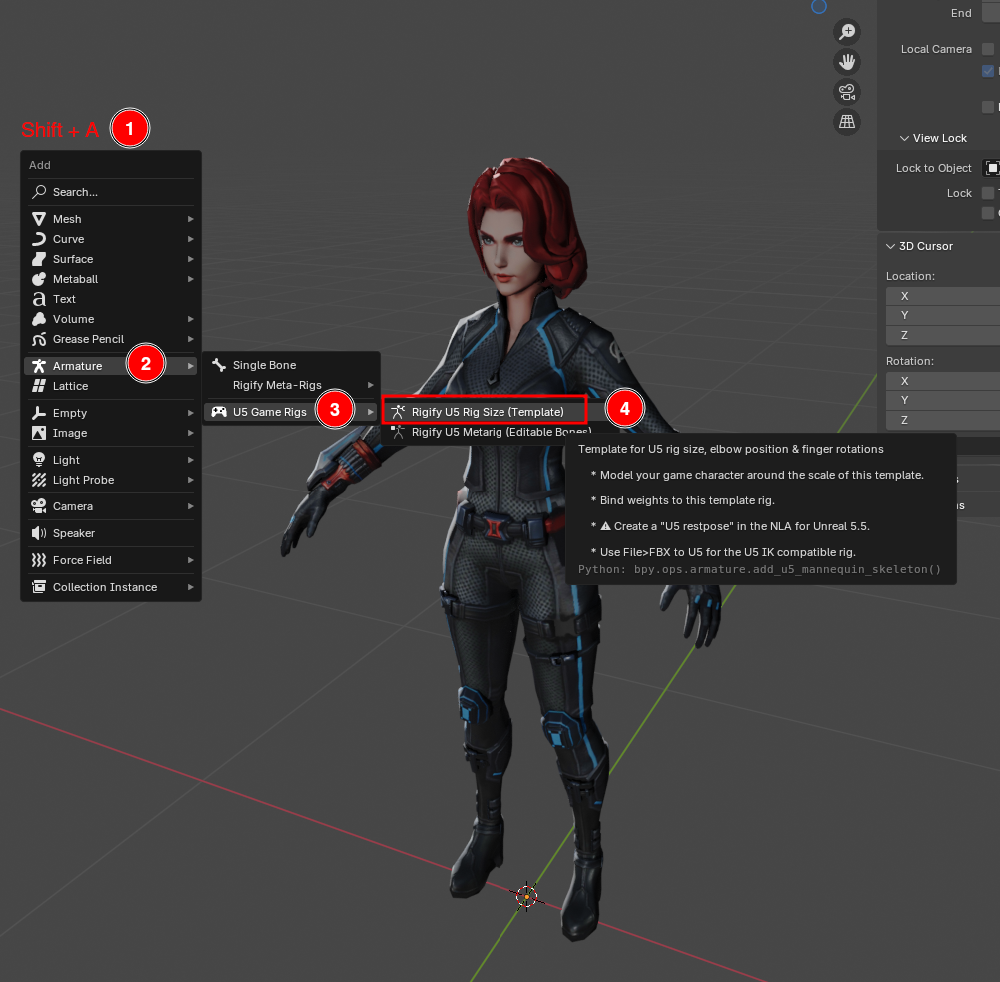
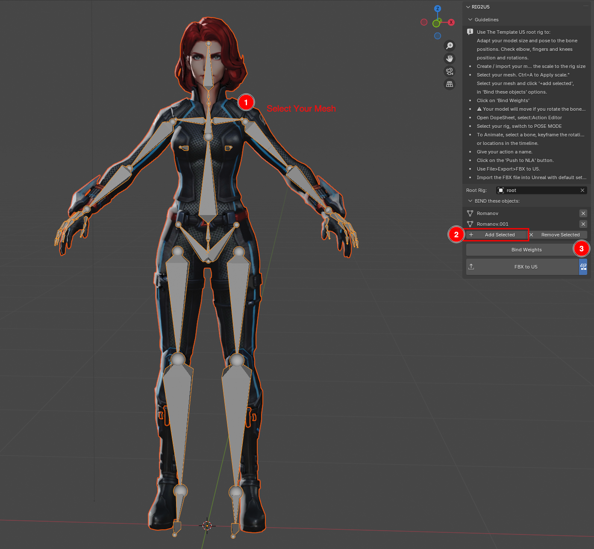

# Root Rig Workflow

Use the template U5 root rig to match your model's size and pose to the bone positions, and to check elbow, finger and knee positions and rotations.

## 1. Add the template

**Shift+A > U5 Game Rigs > Rigify U5 Rig Size (Template)**. This adds the root rig and sets the scene scale for Unreal Engine 5.

## 2. Prepare your mesh

- The rig will probably be much larger than your model. Scale the model up (usually x100) to match it.
- Select the mesh and press **Ctrl+A** to apply scale.

## 3. Bind your mesh

- Select the mesh and click **+ Add Selected** under **BIND these objects**.
- Click **Bind Weights**.

## 4. Check your model

Rotate a few bones: the model should follow. Weight paint where needed.

## 5. Animate

- Open the Dope Sheet and switch to **Action Editor**.
- Select the rig and enter **Pose Mode**.
- Select a bone and keyframe its rotation or location.
- Name your action.

## 6. Export

- Click **Push to NLA**.
- Use **File > Export > FBX to U5**.
- Import the FBX into Unreal with default settings.
