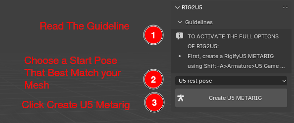
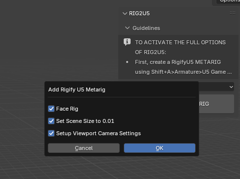

# U5 Metarig Workflow

## 1. Pick a starting pose

Read the guideline in the panel first.

Choose the pose closest to your mesh:

- U5 Rest Pose (default)
- U5 A Pose
- T Pose
- X Pose (experimental)
- U4 A Pose

## 2. Create the metarig

Click **Create U5 Metarig**. You can choose whether to include the face rig.

## 3. Adjust the metarig

The scene size and camera are set to Unreal scale. Edit the metarig to fit your model.

- Do not separate bone ball joints.
- Do not rename bones.
- To add an external rig (hair, tail, weapon), use the **Rigify Integration** section.
- To start over, click **DELETE ALL RIGS & RESET SCENE**.

When the metarig matches your model, click **Generate U5 Rig**.

## 4. Bind and weight

- Add your mesh with **Add Selected** under **BIND these objects**, then click **Bind Weights** for automatic weights.
- Use **Detach Root Rig** / **Attach to Control Rig** while weight painting, as needed.
- **Copy Weight From Selection** and **Normalize and Smooth** help with clean-up.
- **Weight Transfer** copies weights from one object to several others.

## 5. Animate

Animate with the Rigify controls, then push each animation to the **NLA**.

## 6. Export

Check that every animation you want is in the NLA, then click **FBX to U5**. The side panel lists the actions that will be baked and exported.

## 7. Send to Unreal

Import the FBX into Unreal. The rig is ready to use.
